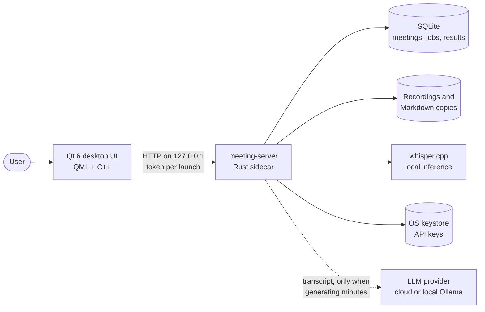
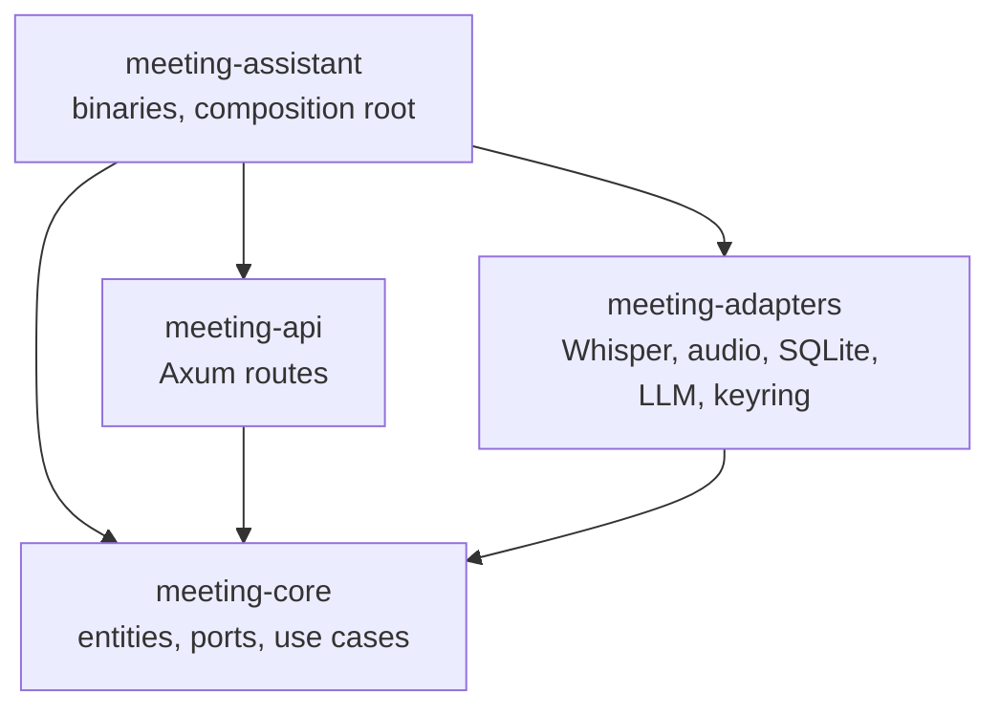
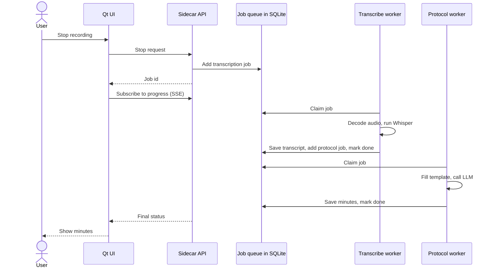
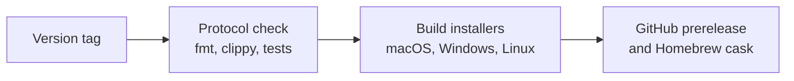

# Architecture

Meeting Assistant is two programs that ship together: a Qt 6 desktop UI and a Rust
sidecar that does the work. In the code, "protocol" means meeting minutes.

## System overview

The GUI finds `meeting-server` next to its own executable and starts it. The
sidecar then follows a strict contract:

- It binds `127.0.0.1:0` and refuses any non-loopback address.
- It prints one JSON handshake line to stdout: port, 256-bit bearer token, protocol
  range, and build. All logs go to stderr.
- Every `/api/*` route requires the token, and a global rate limit caps requests.
- It exits when the GUI dies, detected by an inherited pipe on POSIX and by a Job
  Object or PID polling on Windows.
- A file lock allows only one running instance.

## Code layers

`meeting-core` has no dependency on the other crates. Use cases depend only on port
traits, and adapters implement them, so use cases are tested with fakes behind the
`fakes` feature. Settings and secrets stay outside the core: they are wired in the
composition root, and the API layer resolves values such as the default template
before calling a use case.

## From recording to minutes

## Key decisions

### Sidecar over FFI

The boundary between UI and core is loopback HTTP. There is no cxx-qt or
qt-build-utils in the build. Rust and Qt build independently with their own tools,
the API is tested with ordinary HTTP tests, and a crash in native audio or inference
code leaves the UI running, so `SidecarManager` can restart the sidecar or report the
failure. The cost is an API to secure and a protocol version to negotiate.

### One source for the IPC version

`PROTOCOL_VERSION` is defined once, in `rust/crates/api/src/lib.rs`. CMake generates
the Qt client's constant from it at build time, and CI fails if the two differ. The
GUI refuses to continue when its version falls outside the sidecar's supported range.

### Background jobs

Transcription and minutes generation are jobs stored in SQLite. Two workers run side
by side, a CPU-bound transcription worker and an IO-bound protocol worker, each with
its own concurrency limit, so a long transcription does not hold up minutes for
another meeting.

Live progress stays in memory and is streamed over SSE, with polling as a fallback.
Cancellation is cooperative: workers check a token at safe checkpoints, and
whisper.cpp checks an abort flag between segments.

### Results survive failures

A job becomes `done` only after its transcript or minutes are saved in SQLite. The
per-meeting `transcript.md` and `protocol.md` files are secondary copies, so a
filesystem error is logged without losing the result. If saving fails, the job is
retried, and a retry reuses a result that is already saved. It does not repeat Whisper
inference or send another paid LLM request.

### Audio capture

| OS | Microphone | System audio | Device selection |
|---|---|---|---|
| macOS | cpal | ScreenCaptureKit | Microphone only, because ScreenCaptureKit captures the whole system mix |
| Windows | cpal | WASAPI loopback | Microphone and output device |
| Linux | PulseAudio/PipeWire via `parec` | Monitor source via `parec` | Microphone and monitor source |

Linux skips cpal because its default ALSA host lists dozens of pseudo-devices that
are unusable in a picker. Devices are stored by name, because no stable cross-platform
ID exists. If a saved device has gone, capture falls back to the OS default and the UI
shows the device actually opened.

Recording both sources writes each to its own temporary file, and ffmpeg mixes them
afterwards. On macOS the two backends run on independent audio clocks, so the mix
filter compensates for drift. Optional echo cancellation subtracts system audio from
the microphone track. Installers bundle an LGPL build of the ffmpeg CLI next to the
sidecar, so users don't need to install it.

### Whisper backends

whisper.cpp links its compute backend at build time, so the choice belongs to the
build, not to runtime:

- **macOS:** Metal by default. It is a system framework, so it adds no install step
  or signing surface.
- **Windows and Linux:** CPU in release builds. CUDA and Vulkan are opt-in cargo
  features, because they need an SDK at build time and NVIDIA-only CUDA does not suit
  a single portable build. See the
  [Vulkan release build idea](../backlog/whisper-gpu-release-build.md).

`build.rs` derives the backend from the same rules as `Cargo.toml`, and the settings
screen shows it. A runtime `use_gpu` switch lets users force CPU on accelerated builds.
CPU builds show a plain note instead of a switch that does nothing.

The CPU instruction set is also fixed at build time. Every build pins it in
`.cargo/config.toml` instead of tuning for the machine doing the build, so a release
doesn't depend on which runner it landed on: AVX2 on x86-64, the M1's features on Apple
silicon. CI reads the built binary to check. See
[`packaging/README.md`](../packaging/README.md).

### API key storage

Keys never go into `settings.json`, and the API exposes only `has_key`, never the
value.

- **Default:** the OS keystore: Keychain, Credential Manager, or Secret Service.
- **Fallback:** when no keystore is available, a `0600` file, which the UI discloses
  openly. The user can upgrade it to a passphrase vault using Argon2id and
  XChaCha20-Poly1305.
- **Environment variables:** the store ignores ambient ones such as
  `ANTHROPIC_API_KEY`, so the app uses exactly the key the user configured.

Encryption without user input needs a hardware root of trust, which is what the
keystore already provides. Outside it, the honest choices are a passphrase or
plaintext, so the app offers both and says which is active.

### TLS without OpenSSL

The sidecar uses rustls. The Linux AppImage used to carry OpenSSL 1.1.1 from its build
container, and on a host whose `openssl.cnf` registered an OpenSSL 3 engine (Astra
Linux with GOST), both libcrypto versions loaded into one process and the sidecar
crashed before logging a line. With rustls, TLS no longer depends on the host's
OpenSSL, and a regression test guards the choice.

### Settings apply live

Changing the LLM provider, Whisper preferences, or prompts folder takes effect
immediately. The active LLM sits behind an `ArcSwap`. Only the database and recordings
paths need a restart, because long-lived components hold them, and the UI shows a
banner for those.

### Templates

Built-in templates are embedded in the binary, one set per language. At startup, any
of the active language that are missing are copied to a per-user folder, where the user
can edit them. Copying never overwrites, and it skips built-in templates the user has
deleted, so upgrades add new templates without disturbing customizations. A template
fixes the language of its output, so minutes follow the template, not the interface.

### Interface language

The app runs in Russian or English: an explicit choice wins, a Russian system gets
Russian, and any other system gets English. The choice is stored by the GUI rather than
the sidecar, because the GUI needs it before the sidecar is running, and a new choice
applies after a restart so that one run keeps one language.

Russian stays the source language of the UI strings, so only the English translation
exists as a file. The sidecar holds no UI language: it reports stages, error classes,
and notice codes, and the GUI turns them into text. It uses the language only to choose
which templates to seed.

### Database migrations

SQL migrations are embedded and applied at startup by a small local runner on
rusqlite. A future migration can include optional `down` SQL, used only by the
developer command `meeting-server --rollback-one`. Normal startup never rolls back. A
migration framework would add a dependency without solving a current problem.

### No voice activity detection

VAD is not wired in. In `whisper-rs` it needs a separate Silero model file, which adds
a signed asset and version management without changing transcription correctness. It
can be revisited if real recordings show significant time wasted on long silences.

## Testing

- **Use cases:** run against fakes.
- **Adapters:** cover SQLite, the worker, and audio recovery. Each LLM wire format is
  tested against `wiremock`.
- **IPC contract:** `sidecar_contract.rs` covers the handshake, auth, lifecycle, and
  job progress.
- **Qt:** an offscreen smoke test drives the real `SidecarManager` and `ApiClient`,
  and QML integration tests cover screen behaviour.
- **Regressions:** every bug fix adds a test at the lowest level that reproduces it.

CI cannot cover real microphones, OS permissions, or installers, so each release also
goes through a manual [smoke checklist](../packaging/SMOKE-CHECKLIST.md) on all three
systems.

## CI and releases

Every push runs the same quality gate, then builds both binaries and runs the tests
on all three systems. Linux builds run in an `ubuntu:20.04` container to keep a low
glibc floor. The Rust toolchain is pinned in `rust-toolchain.toml`, so a new stable
release cannot break the gate without a code change.

Qt and FFmpeg are used under the LGPL, and every installer includes the license texts
and written offers from [`packaging/LICENSES`](../packaging/LICENSES). The bundled fonts
are under the SIL Open Font License, and their licenses from
[`qt-app/fonts`](../qt-app/fonts) ship in the same folder.
See [`packaging/README.md`](../packaging/README.md) for per-OS details.
